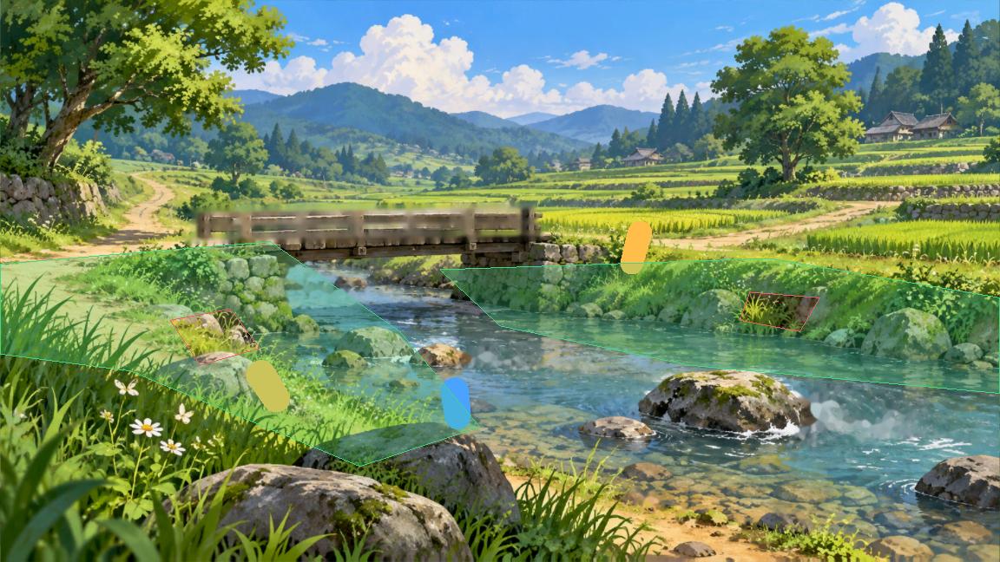

# Illustrated Walkmesh Editor (IWE)

  
  
  

## What is it?

Illustrated Walkmesh Editor is a Godot 4 editor plugin that turns a painted background into an authored, playable 2.5D space. You draw the walkable areas directly over the illustration, carve out obstacles, calibrate the perspective with character references, and export a Godot scene with navigation and collision that a character can use.

## Documentation

- [User guide](docs/USER_GUIDE.md): installation, workflow, and current limits.
- [FAQ](docs/FAQ.md): common questions about scope, saving, and licensing.
- [Development guide](docs/DEVELOPMENT.md): setup, pinned tool versions, and headless tests.
- [Data format](docs/DATA_FORMAT.md): saved document versions and compatibility rules.
- [Specification](docs/SPECIFICATION.md), [architecture](docs/ARCHITECTURE.md), and [roadmap](docs/ROADMAP.md).
- [Changelog](CHANGELOG.md), [contributing](CONTRIBUTING.md), [security](SECURITY.md).

## Features

Three levels, so you know what you can rely on today. The [roadmap](docs/ROADMAP.md) has the order of work.

### Available

Implemented and covered by automated tests. Most were also checked in the editor; the 2D export has so far been tested headless only.

- **Illustration.** Import a PNG, JPG, or WebP image, then pan and zoom. Authored geometry is stored in image pixels, so zoom never changes it.
- **Walkable polygons.** Draw, select, move, and edit polygons vertex by vertex. Add or remove points, duplicate, rename, hide, and delete. Edits support undo and redo, with a separate history per document.
- **Groups and cutouts.** Organize regions into flat groups. Cut holes (lakes, rocks) into a region with named cutouts.
- **Touching and overlapping zones.** Zones that share an edge (in full or in part) or overlap form one walkable network: the shared part has no wall and the character walks from one to the other. Zones stay separate, or you can merge two of them into one polygon with `Merge with…` (undoable).
- **Scene export.** Export a standalone 2D scene or a flat 3D stage. Each export contains one navigation region per walkable zone. The 3D stage nests them under their groups.
- **Save and reopen.** Save an IWE document as a `.tres` file. The illustration is copied next to it, and reopening restores regions, cutouts, and templates.
- **Floating window.** Open the illustration editor in a large separate window.
- **Layers and pictures.** A Background and a Foreground layer; place transparent PNG or WebP pictures on them (position, scale, opacity, ground point), hide, lock or fade a layer, with undo. A picture can be drawn behind the character, in front of it, or by depth, so the character walks behind a fountain and in front of it. Pictures never block walking. The perspective and 2D exports include them. The picture is positioned by typing numbers; there is no mouse dragging yet.
- **Dock in two tabs.** *Creation* (layers, regions, tools, references, camera) and *Test* (test character, export, validation), with foldable sections.

### Experimental

Implemented and tested headless, but the editor interaction has not been checked end to end. Expect rough edges and possible changes.

- **Perspective calibration.** Place character height references at different depths, then fit the camera to them. The illustration is warped onto a flat virtual floor. This does not infer terrain height or hidden depth.
- **Perspective export.** The calibrated stage gets collision walls on the outer outlines of walkable zones. Shared edges stay open.
- **Test character.** The perspective stage can include a character that walks on click or with the keyboard, stays inside walkable areas, and is drawn at the size the calibrated camera gives its position. The `Test walk` mode of the dock shows it in the preview, with a base speed and x1, x2, x5 and x10 presets, pause and reset.
- **Calibration report.** After a fit, each height reference shows how far the camera is from it, with a warning above 5%, the horizon row, and the zones above it (which are not exported).

### Planned

Not implemented. Do not rely on these yet.

- Intersection and XOR operations. (Union is available as `Merge with…`.)
- Explicit connections between regions (bridges with a width and a direction).
- Region types: connection, collision only, special.
- Nested layers, layer ordering, rotation, pivot and flip of pictures, mouse dragging of pictures.
- Parallax. An occlusion study is in `prototypes/occlusion/`.
- Nested groups and assisted calibration.

## Example scene

Open `examples/perspective_calibration_demo.tscn` to see a ready-made perspective stage with two walkable zones, a cutout in each, a perspective camera, a top camera, and near and far height references. It uses `assets/img/background.png`.

## Installation

IWE is pre-release. The Asset Library is not available yet, so install it from the repository.

1. Copy the `addons/illustrated_walkmesh_editor/` folder into the `addons/` folder of your Godot 4.7 project. Create `addons/` if it does not exist.
2. Open the project in Godot 4.7.
3. Enable the plugin under **Project → Project Settings → Plugins** by ticking **Illustrated Walkmesh Editor**.
4. The **IWE** dock appears in the right-hand dock area.

The plugin needs no other addon. It was verified by enabling it alone in an empty Godot 4.7.1 project.

For a full walkthrough, see the [user guide](docs/USER_GUIDE.md).

## Roadmap

The planned order of work is in [`docs/ROADMAP.md`](docs/ROADMAP.md). Layers, pictures and depth occlusion are in. Next are the validation of the editor with a mouse, release preparation, then region types and explicit connections. Intersection and XOR are planned as scoped, non-destructive modifiers.

## Contributing

Bug reports, feature requests, and pull requests are welcome. Read [CONTRIBUTING.md](CONTRIBUTING.md) first; it also explains the policy for AI-assisted contributions. Use GitHub Issues for bugs, feature requests, and questions.

## Repository layout

- `addons/illustrated_walkmesh_editor/`: the plugin (the only folder you need to install).
- `examples/`: the perspective demo scene and its generator.
- `prototypes/`: standalone experiments that are not part of the plugin (for example, transparency modes for occlusion).
- `tests/`: headless regression tests (GdUnit4).
- `docs/`: specification, architecture, guides, and design notes.
- `assets/`: images used by the demo and the prototypes, with [provenance](assets/README.md).

Third-party addons used during development are not part of this repository. UniBuilder is under a commercial licence and is not redistributed.

## Status

Pre-release (`0.1.0-dev`). Expect breaking changes to the saved document format until a stable version is announced. Do not use it for production data without keeping a backup.

## About the Project & AI-Assisted Development

This project started from a personal need.

As a developer and digital artist, I wanted a simple and intuitive way to turn 2D illustrations into navigable 2.5D environments in Godot, without having to manually rebuild everything in 3D.

I couldn't find a tool that matched exactly what I had in mind, so I decided to create my own.

While I have a background in development, I'm using AI-assisted coding tools, particularly **Claude Code**, to help design, implement, improve, and maintain this plugin.

I'm not trying to hide the fact that AI is involved in its development. On the contrary, I see it as an opportunity to bring ideas to life, explore technical solutions, and learn along the way.

The original idea, functional requirements, creative direction, and development priorities come from me, while AI helps turn that vision into working code.

### An Open-Source Project

I'm initially building this plugin for my own Godot projects, but I believe it could also be useful to other developers and artists working on similar 2.5D games.

That's why I've decided to share it as an open-source project.

### Feedback & Contributions Welcome

This is an evolving project, and I'm always interested in hearing new ideas.

If you have suggestions, discover bugs, or think of features that could improve the plugin, feel free to open a GitHub Issue or start a discussion.

I'll do my best to review suggestions and, whenever possible, implement improvements with the help of Claude Code and other development tools.

I can't promise that every feature request will be implemented, but constructive feedback is always appreciated.

**The goal is simple: build a useful tool, share it with the community, and keep improving it together.**

## Credits

- [Godot Engine](https://godotengine.org/) for the engine and its editor APIs.
- [GdUnit4](https://github.com/godot-gdunit-labs/gdUnit4) for the test framework (MIT, installed for development and CI only).
- The structure of this README was inspired by [Phantom Camera](https://github.com/ramokz/phantom-camera) (MIT).

## License

IWE is distributed under the MIT License. See [LICENSE](LICENSE).
